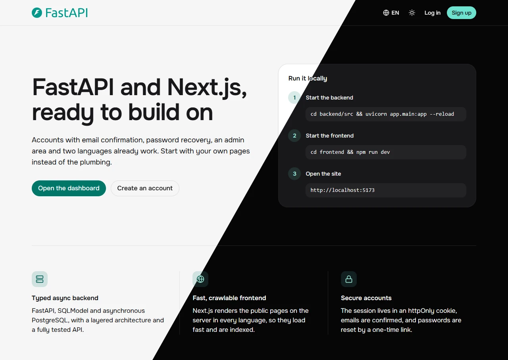

<!--suppress ALL -->
<p align="center">
    <a href="https://www.python.org/downloads/release/python-3130/">
        
    </a>
    <a href="https://pypi.org/project/fastapi/0.165.0/">
        
    </a>
    <a href="https://pypi.org/project/sqlmodel/0.0.50/">
        
    </a>
    <a href="https://pypi.org/project/SQLAlchemy/2.1.9/">
        
    </a>
    <a href="https://pypi.org/project/pydantic/2.14.4/">
        
    </a>
    <a href="https://pypi.org/project/uvicorn/0.54.0/">
        
    </a>
    <a href="https://pypi.org/project/loguru/0.8.0/">
        
    </a>
</p>
<p align="center">
    <a href="https://www.npmjs.com/package/next/v/16.4.6">
        
    </a>
    <a href="https://www.npmjs.com/package/react/v/19.3.1">
        
    </a>
    <a href="https://www.npmjs.com/package/typescript/v/6.0.3">
        
    </a>
    <a href="https://www.npmjs.com/package/@heroui/react/v/3.2.7">
        
    </a>
    <a href="https://www.npmjs.com/package/tailwindcss/v/4.3.5">
        
    </a>
    <a href="https://www.npmjs.com/package/@tanstack/react-query/v/5.108.2">
        
    </a>
    <a href="https://www.npmjs.com/package/next-intl/v/4.15.3">
        
    </a>
</p>
<p align="center">
    <a href="https://github.com/astral-sh/ruff">
        
    </a>
    <a href="https://github.com/iRingil/full-stack-fastapi-template/actions/workflows/lint.yml">
        
    </a>
    <a href="https://github.com/iRingil/full-stack-fastapi-template/actions/workflows/pytest.yml">
        
    </a>
    <a href="https://github.com/iRingil/full-stack-fastapi-template/actions/workflows/frontend.yml">
        
    </a>
    <a href="https://github.com/iRingil/full-stack-fastapi-template/blob/master/LICENSE.md">
        
    </a>
</p>

# Full Stack FastAPI Template

A starting point for a web application: a **FastAPI** backend with **PostgreSQL** and a **Next.js** frontend, with
user accounts, an admin area and a sample "items" resource already in place.

It is a fork of [fastapi/full-stack-fastapi-template](https://github.com/fastapi/full-stack-fastapi-template),
rewritten with a layered, object-oriented architecture on both sides, hardened against the common attacks on login
and accounts, and covered by tests line for line. It runs without Docker: the backend under Uvicorn, the frontend
as a Node.js server, nginx in front of both.

<p align="center">
    
</p>

### Features

- **Accounts** - sign-up with email confirmation, login, password recovery by email, a profile page where users
  change their name, email (the current password is required) and password, or delete their account.
- **Admin area** - superusers list, create, edit, deactivate and delete users.
- **Items** - a sample resource with ownership: users see and edit their own items, superusers see everyone's.
- **Security** - the session token lives in an httpOnly cookie and never reaches JavaScript; logout, a new
  password and a password reset revoke every issued token; rate limits on login, sign-up and password recovery
  per IP, and a lock after 5 failed logins per account; sign-up, login and recovery do not reveal which emails are
  registered; passwords are checked against a list of the most common ones; cross-site writes are rejected.
- **English and Russian** interface; the public pages are static, localized and indexed (metadata, sitemap,
  robots.txt).
- **Light and dark themes** in FastAPI's teal, with every text color checked for contrast (WCAG 2.2 AA and APCA).
- **Emails** - HTML with a plain-text alternative, from Jinja2 templates.

### Architecture

**Backend** (`backend/src/app`): routes are class-based views; every FastAPI dependency is a provider class in
`api/deps.py`; database access goes only through repository classes (`crud/`) over a generic base; settings,
the database, security and email are singletons in `core/`, built from their dependencies so that they are easy
to test. Every log line is one line, exceptions included - no tracebacks.

**Frontend** (`frontend/src`): the browser talks only to the Next.js server, which proxies `/api/v1/*` to the
backend and keeps the token in the cookie. Server state is handled by TanStack Query with options generated from
the backend's OpenAPI schema; UI primitives over HeroUI live in `components/ui`, features in `components/<Feature>`.

More detail: [backend/README.md](backend/README.md), [frontend/README.md](frontend/README.md).

### Requirements

- Python 3.13
- Node.js - the version in `frontend/.nvmrc`
- PostgreSQL
- An SMTP server for the emails (optional in development)

### Installation

```bash
git clone https://github.com/iRingil/full-stack-fastapi-template.git
cd full-stack-fastapi-template

# Backend
cd backend
python3.13 -m venv .venv
source .venv/bin/activate
pip install -r src/requirements.txt
cp src/.env.example src/.env

# Frontend
cd ../frontend
npm install
cp .env.example .env
```

### Setup and run

1. Fill in `backend/src/.env`: the empty variables of the example are required (`PROJECT_NAME`, `ENVIRONMENT`,
   `SECRET_KEY`, `FIRST_SUPERUSER`, `FIRST_SUPERUSER_PASSWORD`, `POSTGRES_SERVER`, `POSTGRES_USER`, `POSTGRES_DB`),
   the commented ones show their defaults. `ENVIRONMENT=local` opens the API docs at `/docs`.
2. Create the tables and the first superuser: `cd backend/src && python -m app.initial_data`
3. Run the backend: `cd backend/src && uvicorn app.main:app --reload --log-config log_config.yaml`
4. Run the frontend: `cd frontend && npm run dev`, then open [http://localhost:5173](http://localhost:5173)

`frontend/.env` already points at the local backend (`API_URL`) and site (`SITE_URL`). Logs are written to
`backend/src/logs/`.

### Localization

The texts are in `frontend/messages/en.json` and `ru.json`, grouped by section; components read them by key
(`useTranslations("Login")`, then `t("title")`). There is nothing to extract or compile: add a key to both files
and use it. The keys are typed from `en.json`, so `npm run typecheck` fails on a key that does not exist, and a
test fails when `ru.json` misses a key or has an extra one. To add a language, add its code to
`src/i18n/routing.ts` and a `messages/<code>.json` with the same keys.

### Development

```bash
# Backend (from backend/)
pip install -r src/requirements-dev.txt
ruff check src tests          # lint (Ruff, installed globally - version pinned in .github/workflows/lint.yml)
ruff format src tests         # format
basedpyright                  # type check (installed globally, reads the packages from .venv)
pytest -c pyproject.toml tests --cov

# Frontend (from frontend/)
npm run lint                  # Biome: lint and format
npm run typecheck
npm run coverage              # Vitest
npm run generate-client       # after a change of the backend's API (the backend must be running)
```

Both test suites fail below 100% coverage of lines and branches. The backend tests run against a real
PostgreSQL (`127.0.0.1:5432`, database `test_db`, user `test_user` / `test_password`, schema `test_schema`) -
see `backend/tests/conftest.py`; CI starts it as a service container.

### Installation on a server

`infrastructure/` holds the reference configs for a Linux server, with the install steps in each file's header:

- `nginx/app.conf` - TLS, the security headers (CSP, HSTS, ...), the request size limit and the client address
  for the rate limiters;
- `systemd/` - `app.target` with the backend (Uvicorn on `127.0.0.1:8000`) and the frontend (the standalone
  Next.js server on `127.0.0.1:5173`), running as the user `app` from `/opt/app`;
- `logrotate/app` - daily rotation of the backend log and the frontend output.

Set `ENVIRONMENT=production` in `backend/src/.env` and the public address of the site in `SITE_URL` of
`frontend/.env`.

### Developers

* [Ringil](https://github.com/iRingil)

### Licenses

* The source code is available under the [MIT](https://github.com/iRingil/full-stack-fastapi-template/blob/master/LICENSE.md)
  license; it keeps the copyright notice of the original
  [Full Stack FastAPI Template](https://github.com/fastapi/full-stack-fastapi-template) by Sebastián Ramírez,
  released under the same license
* [Onest](https://fonts.google.com/specimen/Onest) typeface - [SIL Open Font License 1.1](https://openfontlicense.org)
